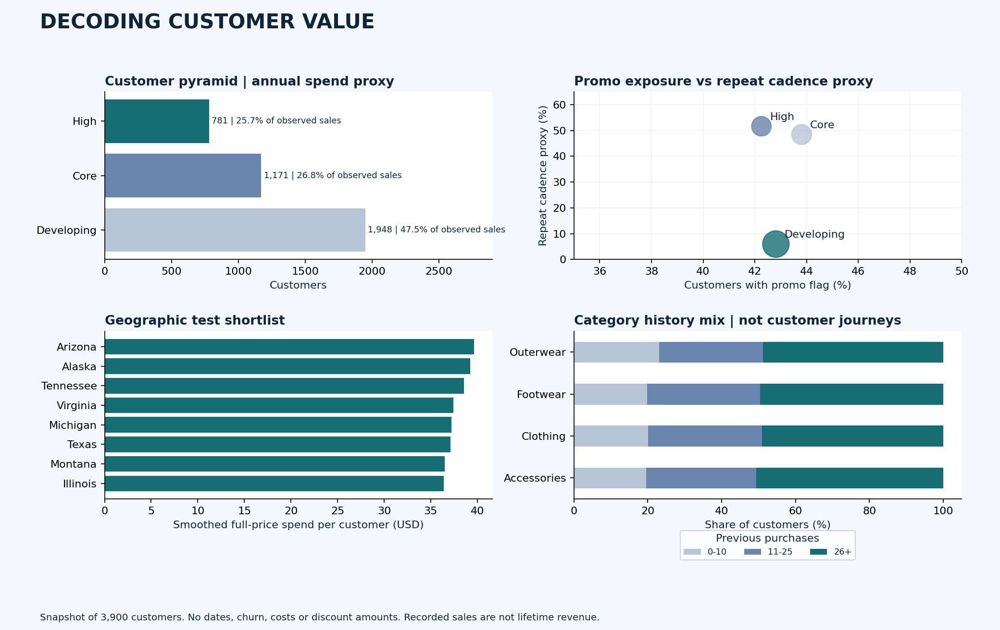

# Decoding Customer Value
### A SQL-Driven Retention Strategy

**Python · SQL · Power BI · Customer Analytics**  
**Author:** Soumabha Bhim

**[View Interactive Dashboard](https://s-bhim.github.io/customer-value-retention-analytics/)**

An end-to-end portfolio case study analyzing **3,900 customers** of a US D2C fashion brand to understand customer value, promotional exposure and opportunities for targeted retention.



*Python-generated analytical overview; not a Power BI screenshot.*

## Key findings

- **42.65% of $233,081 recorded sales** carried a promotion flag.
- **1,086 customers (27.85%)** met the primary repeat-cadence proxy: 26+ previous purchases and at least monthly stated purchasing frequency.
- **74 customers** qualified for a proposed controlled discount-reduction pilot.
- **Arizona, Alaska and Tennessee** led the qualified geographic test shortlist.

## What the project delivers

- Cleaned customer data and engineered value, satisfaction and promo-exposure features.
- Two competing loyalty definitions, bootstrap comparisons and threshold sensitivity checks.
- SQL segmentation queries and a populated SQLite database.
- A four-panel Power BI project and interactive offline HTML companion.
- A promotional sunset playbook, ideal customer profile and executive summary.

## Explore the work

| Deliverable | Link |
|---|---|
| One-page executive summary | [Read summary](reports/Executive_Summary.pdf) |
| Full analysis | [Read report](reports/Customer_Intelligence_Report.pdf) |
| Retention recommendations | [Read playbook](reports/Retention_Playbook.pdf) |
| Python analysis | [Open notebook](notebooks/Customer_Intelligence.ipynb) |
| SQL queries | [View SQL](sql/analysis.sql) |
| Hosted dashboard | [View dashboard](https://s-bhim.github.io/customer-value-retention-analytics/) after Pages deployment |
| Offline companion | [Download HTML](dashboard/Founder_Dashboard.html), then open locally |
| Power BI source | [Open project](powerbi/Founder.pbip) · [Setup guide](powerbi/OPEN_IN_POWER_BI.md) |

The dashboard covers customer value distribution, promo exposure versus repeat-cadence proxy, geographic opportunity and category purchase-history mix.

## Repository contents

`src/` Python pipeline · `sql/` query layer · `notebooks/` executed analysis · `data/` customer features and results · `powerbi/` report/model · `reports/` PDFs · `docs/` GitHub Pages dashboard · `validation/` checks

## Run locally

With Python 3.10+ installed, run from the repository root:

```bash
python -m pip install -r requirements.txt
python run_project.py
```

Repeat the data, SQL, PDF and report-schema checks with:

```bash
python validation/validate_project.py
```

## Scope and status

The dataset has no timestamps, churn outcomes, discount amounts or product costs. Loyalty and annual spend are explicit **proxies**; promotional exposure does not establish discount dependency. Recommendations and margin scenarios have not been tested in a live business.

The Power BI source passes report-schema and field-reference checks. **Power BI Desktop refresh and visual validation remain pending; a Desktop-tested `.pbix` is not included.** The HTML companion has been tested in Chrome.

Source: supplied assignment dataset; public-source attribution and redistribution permissions were not provided. AI tools assisted with implementation and documentation. See the [feature dictionary](data/FEATURE_DICTIONARY.md) and [validation notes](validation/VALIDATION_NOTES.md) for definitions and checks.
